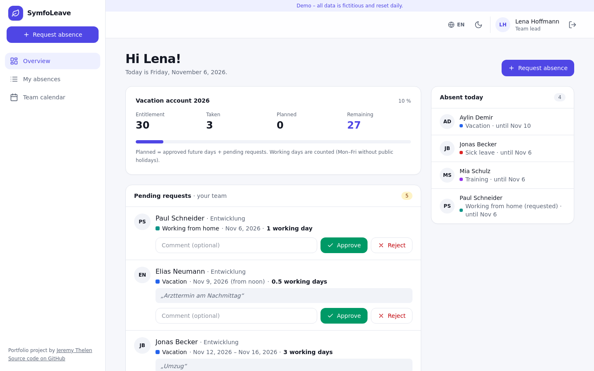
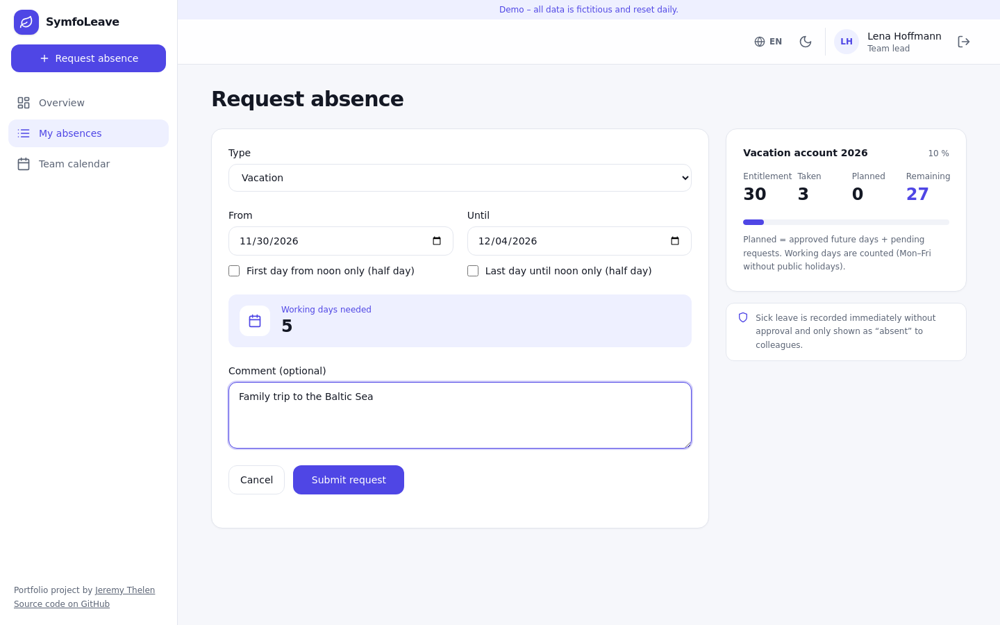
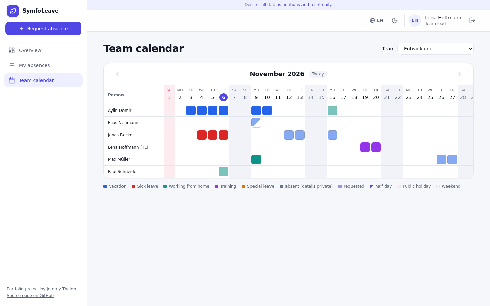
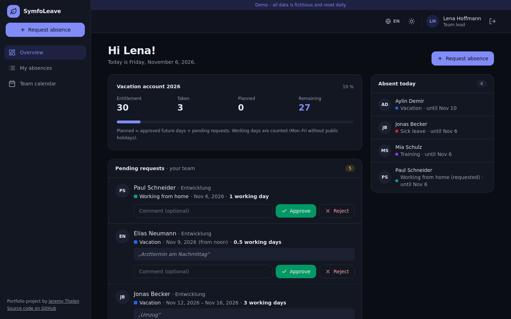
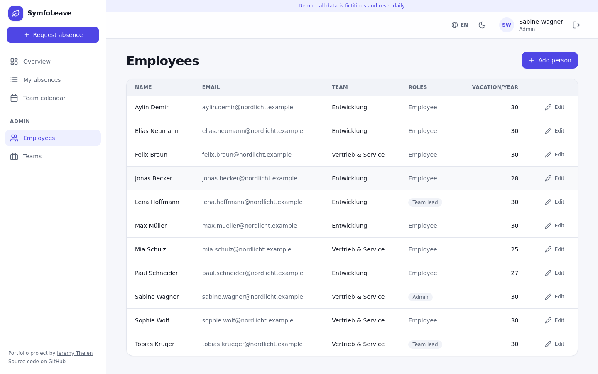
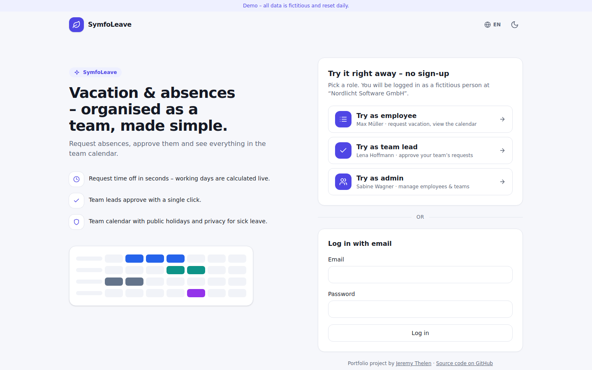
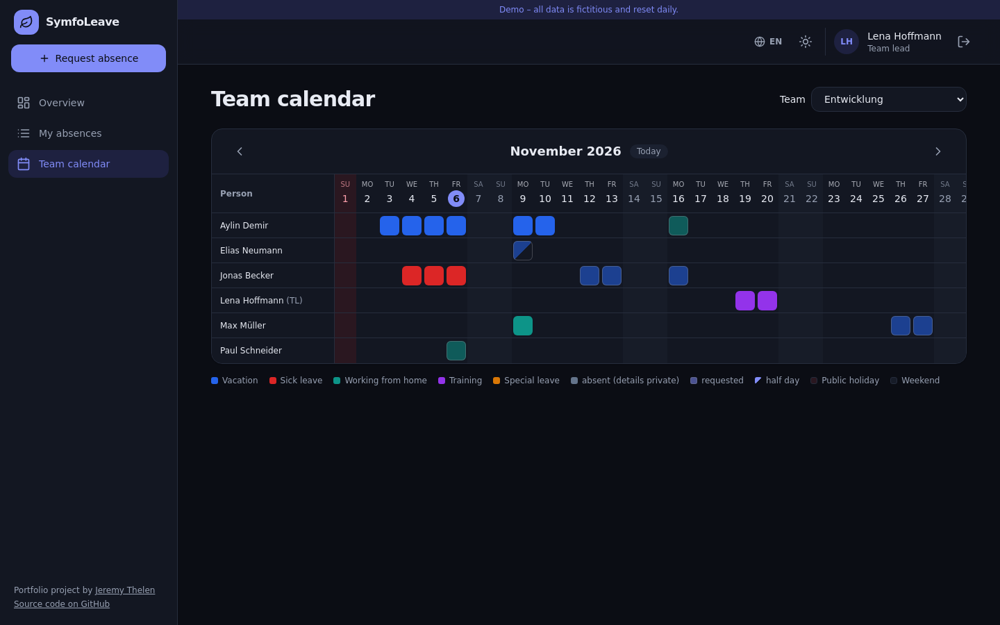
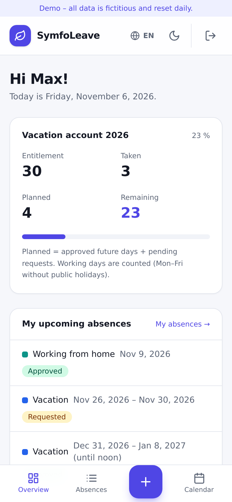
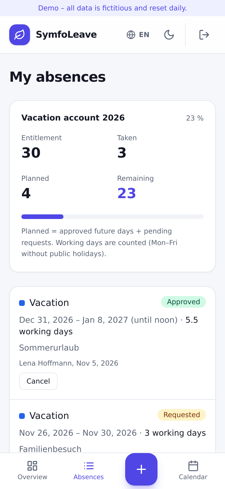
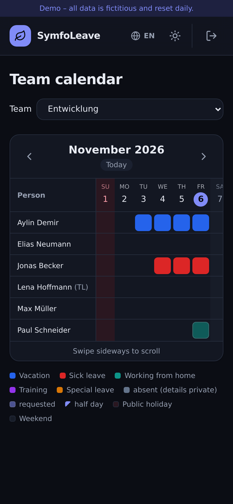

<p align="center">
  
</p>

<p align="center">
  <strong>Lean absence management built with Symfony</strong><br>
  Request time off, approve it with one click and see the whole team at a glance.
</p>

<p align="center">
  
  
  
  
  
  
</p>

<p align="center">
  <a href="https://symfoleave.jeremythelen.de"><strong>Live demo</strong></a> ·
  <a href="#features">Features</a> ·
  <a href="#screenshots">Screenshots</a> ·
  <a href="#quick-start">Quick start</a> ·
  <a href="#deployment">Deployment</a> ·
  <a href="#architecture">Architecture</a>
</p>

<p align="center">
  
</p>

## Overview

SymfoLeave is a small, production-ready absence management tool. Employees request vacation, sick leave, remote work and more; team leads approve or reject; everyone sees a month calendar of their team with public holidays. Working days, half days and the yearly vacation account are calculated for you.

> **Try it:** open the [live demo](https://symfoleave.jeremythelen.de) and sign in with one click as **employee**, **team lead** or **admin** – no registration. All data is fictitious and reset every night.

## Screenshots

<table>
  <tr>
    <td width="50%"><br><sub><b>Request form</b> – working days are calculated live</sub></td>
    <td width="50%"><br><sub><b>Team calendar</b> – people × days, holidays and weekends highlighted</sub></td>
  </tr>
  <tr>
    <td width="50%"><br><sub><b>Dark mode</b> – follows the system, switchable any time</sub></td>
    <td width="50%"><br><sub><b>Admin</b> – employees, roles, teams and entitlements</sub></td>
  </tr>
  <tr>
    <td width="50%"><br><sub><b>Login</b> – one-click demo roles</sub></td>
    <td width="50%"><br><sub><b>Calendar in dark mode</b></sub></td>
  </tr>
</table>

<table>
  <tr>
    <td width="33%" align="center"><br><sub><b>Mobile</b> – tab bar with “+” button</sub></td>
    <td width="33%" align="center"><br><sub><b>My absences</b> – tables become cards</sub></td>
    <td width="33%" align="center"><br><sub><b>Calendar</b> – sticky names, swipe to scroll</sub></td>
  </tr>
</table>

## Features

### For employees
- **Requests** with date range, optional half day at the start or end, and a comment – the required working days are shown live.
- **Vacation account per year**: entitlement, taken, planned (approved + pending) and remaining, with a warning when the balance goes negative.
- **Sick leave** is recorded immediately, no approval needed.
- **Validation**: end ≥ start, no overlap with your own active absences.

### For team leads
- **Approval workflow** (Symfony Workflow): requested → approved / rejected, requested / approved → cancelled.
- **Dashboard** with pending requests of the team (approve or reject with an optional comment) and who is absent today.
- Team leads can only decide on their own team – and never on their own requests.

### For admins
- Manage **employees, roles, teams, team leads** and the yearly **vacation entitlement**.

### For everyone
- **Team calendar**: month view people × days, color-coded by type, weekends and public holidays highlighted, half days and pending requests visible.
- **Privacy by design**: for private types such as sick leave, colleagues only see “absent” – no type, no comment.
- **Three languages (EN / DE / FR)**: chosen via switcher (cookie) or browser language, German by default. Dates, holiday names and validation messages are localized.
- **Light & dark mode** and a **responsive layout**: sidebar on desktop, bottom tab bar on mobile.

### Under the hood
- **Working-day calculation**: Mon–Fri without public holidays (Yasumi, region configurable, default North Rhine-Westphalia), half days count 0.5, absences spanning New Year are split across both years.
- **Demo mode** (`APP_DEMO=1`): one-click logins, a fictitious company with 11 people in 2 teams, data relative to today, nightly reset.

## Tech stack

| Layer | Technology |
|-------|------------|
| Backend | PHP 8.2+, Symfony 7.4 LTS (Security with voters, Forms, Validator, Workflow, Translation) |
| Persistence | Doctrine ORM + Migrations, MySQL 8 (production) / SQLite (local & tests) |
| Frontend | Twig, AssetMapper, Tailwind CSS 4 (standalone binary, no Node.js), Stimulus |
| Domain | [azuyalabs/yasumi](https://github.com/azuyalabs/yasumi) for public holidays |
| Quality | PHPUnit (unit + functional tests) |

## Quick start

### Requirements

- PHP 8.2+ with `intl`, `pdo_sqlite` (local) or `pdo_mysql`
- Composer
- Symfony CLI (optional)

### Local setup

```bash
git clone https://github.com/JeremyT2002/SymfoLeave.git && cd SymfoLeave
composer install
php bin/console doctrine:migrations:migrate -n
php bin/console app:demo:reset            # or: php bin/console doctrine:fixtures:load -n
php bin/console tailwind:build --watch &  # build the CSS
symfony serve                             # or: php -S localhost:8000 -t public
```

Sign in with one of the demo buttons or e.g. `max.mueller@nordlicht.example` / `demo`.

### Configuration

Override in `.env.local`:

| Variable | Purpose |
|----------|---------|
| `APP_DEMO` | `1` enables one-click demo logins and the demo banner |
| `HOLIDAY_REGION` | Yasumi provider, e.g. `Germany/Bavaria` (default: North Rhine-Westphalia) |
| `DATABASE_URL` | SQLite by default; MySQL in production |
| `TRUSTED_PROXIES` | Set when running behind a reverse proxy |

## Testing

```bash
php bin/phpunit
```

- **Unit tests** for working days (weekends, public holidays, half days, New Year) and the vacation account.
- **Functional tests** for “request → approve”, “team lead cannot approve another team”, overlaps, calendar privacy, demo logins, CSRF protection and language detection.

## Deployment

Target: a VPS with nginx or Apache, PHP ≥ 8.2 and MySQL – no Docker required. SQLite is enough locally and in tests; the migrations support both.

**One-time setup** (as a user with sudo rights):

```bash
curl -fsSL https://raw.githubusercontent.com/JeremyT2002/SymfoLeave/main/deploy/server-setup.sh | sudo bash
```

The script is idempotent and detects the web server, PHP version and web user on its own. It installs missing PHP extensions (no upgrades), clones the repo to `/var/www/symfoleave.jeremythelen.de`, creates `.env.local` with a random `APP_SECRET`, builds the assets, runs the migrations, loads the demo data and adds its **own** vHost (backup → config test → reload, otherwise rollback). It reuses an existing wildcard certificate or runs certbot, installs the nightly demo reset via cron and compares the status codes of all other sites before and after.

| Task | Command |
|------|---------|
| Update | `cd /var/www/symfoleave.jeremythelen.de && bash deploy/deploy.sh` |
| Switch an existing SQLite install to MySQL | `bash deploy/switch-to-mysql.sh` (creates database + user) |
| Reset demo data | `php bin/console app:demo:reset` (works in prod without dev packages; runs nightly at 3:30 on the live demo) |

vHost templates: [`deploy/nginx.conf`](deploy/nginx.conf), [`deploy/apache.conf`](deploy/apache.conf), [`deploy/apache-mod_php.conf`](deploy/apache-mod_php.conf).

## Architecture

Controllers stay thin and delegate to services:

| Service | Responsibility |
|---------|----------------|
| `WorkingDayCalculator` | Working days per year, holidays via `HolidayProvider` |
| `VacationAccountCalculator` | Entitlement, taken, planned, remaining |
| `AbsenceManager` | Requests and status changes through the Workflow component |
| `MonthCalendarBuilder` | Calendar matrix people × days |
| `AbsenceVoter` | All permissions, checked server-side |
| `AbsenceVisibility` | Privacy rule for calendar and dashboard |
| `DemoDataLoader` | Demo company, shared by fixtures and the reset command |

### Technical highlights

- **Testable domain logic** – working days and the vacation account are plain services with unit tests for edge cases (regional holidays, half days, New Year, negative balance).
- **Workflow component as a state machine** instead of scattered `if`s – allowed status changes are declared in config.
- **Permissions via voters** – every POST is CSRF-protected, covered by functional tests.
- **Privacy by design** – visibility per absence type.
- **Modern frontend without a Node toolchain** – AssetMapper, the Tailwind binary and two small Stimulus controllers (live working days, theme switch).
- **Reproducible deployment** – idempotent setup script with config test, automatic rollback and a before/after check of the other sites on the server.

Design decisions are documented in [`DECISIONS.md`](DECISIONS.md).

## License

MIT – see [LICENSE](LICENSE).
